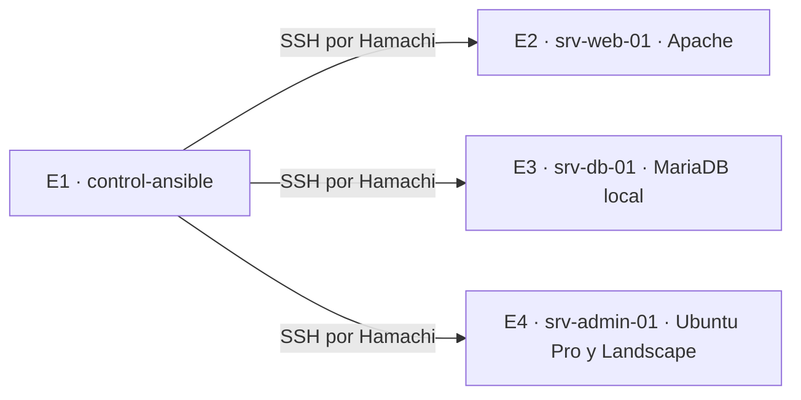

# Guion y checklist de la demostración A16

E4 dirige un ensayo de 10 a 15 minutos con el commit candidato aprobado en [A15](integracion.md). El equipo ejecuta comprobaciones breves en vivo y muestra los reportes sanitizados del ensayo para las operaciones largas. La [matriz](evidencias/MATRIZ_FINAL_EVIDENCIAS.md) identifica las pruebas y a sus responsables.

| Tiempo | Presenta | Guion y evidencia |
|---|---|---|
| 0–3 min | E1 | En `control-ansible`, muestra `git rev-parse --short HEAD`, `git status --short` y `ansible --version`. Explica SSH por llave con `automatizacion`. Abre `inventories/laboratorio/hosts.yml`, ejecuta `ansible-inventory --graph` y `ansible all -m ansible.builtin.ping`. Verifica un `pong` por nodo. |
| 3–6 min | E2 | Abre `playbooks/preparar_laboratorio.yml` y `roles/base/tasks/main.yml`. Compara los recaps de ambas pasadas y explica `changed`. Muestra la plantilla de Apache y ejecuta `curl --fail --show-error -i http://25.32.150.213/` desde el controlador. Señala HTTP 200 y el hostname en la página. |
| 6–9 min | E3 | En `srv-db-01`, ejecuta `sudo mariadb -N -B -e 'SELECT VERSION();'` y `sudo ss -ltnp 'sport = :3306'`. Muestra la escucha local, el inventario de los tres servidores, un log por host y el resumen. Compara pendientes antes y después, estado del reinicio y el reporte separado del fallo controlado. |
| 9–13 min | E4 | Explica las cuatro laptops y los tres enlaces SSH desde el controlador. Presenta el estado sanitizado de Ubuntu Pro y `pro security-status` en `srv-admin-01`. Muestra `systemctl is-enabled landscape-client`, `systemctl is-active landscape-client` y una vista sanitizada del portal con hostname y última comunicación. Cierra con los recaps integrados, el problema de MTU, el manejo de reinicios y los pendientes de A17. |

## Checklist de ensayo y presentación

- [ ] E1 verifica el commit o tag candidato, el grafo, el ping y los recaps de A15 antes de abrir la sesión.
- [ ] Cada propietario tiene su VM disponible y los comandos de su bloque preparados. E4 confirma los tiempos y las transiciones.
- [ ] E2 conserva el HTTP 200 y los recaps de primera y segunda pasada. E3 tiene inventario, resumen, log por host y fallo controlado, todos del ensayo registrado.
- [ ] E4 revisa la captura de Landscape y el extracto de Pro. Oculta nombres de cuenta, credenciales, códigos, tokens e identificadores antes de compartir pantalla o archivos.
- [ ] Si una laptop o el portal no responde durante la exposición, muestra la evidencia previa del commit ensayado, aclara su fecha y explica qué prueba en vivo quedó pendiente. Si falta esa evidencia, marca **EVIDENCIA PENDIENTE DE EJECUCIÓN**.
- [ ] El equipo registra la duración real, incidencias, evidencia disponible y acciones pendientes. E4 aprueba el cierre de A16 antes de fijar [el baseline](baseline.md).

**EVIDENCIA PENDIENTE DE EJECUCIÓN** para el ensayo cronometrado y la demostración.
